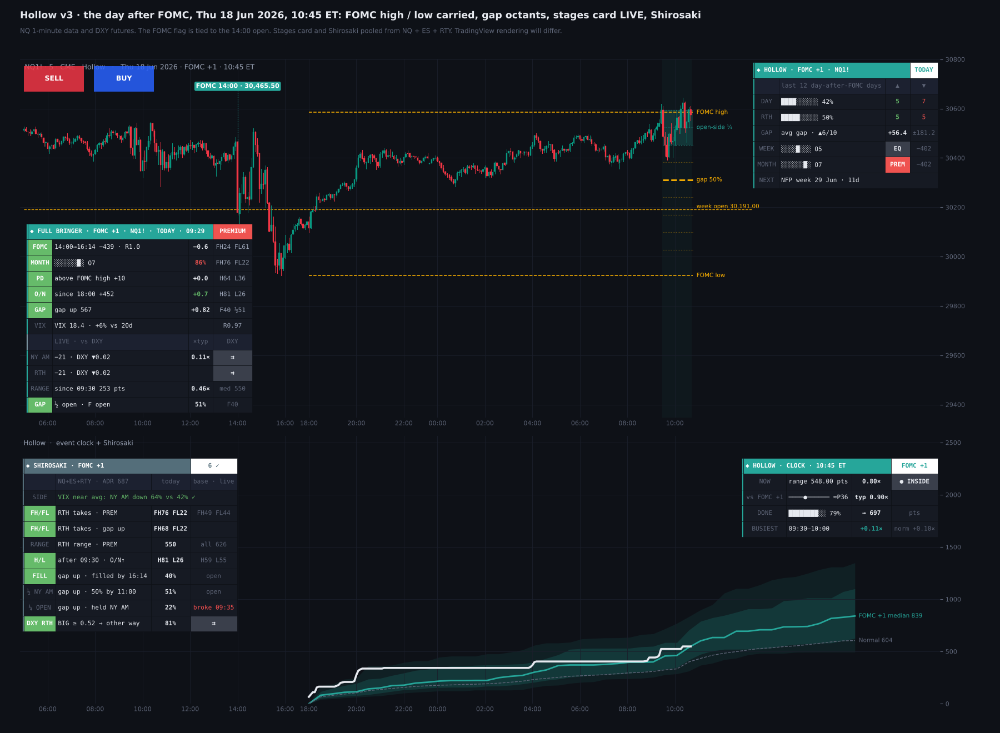
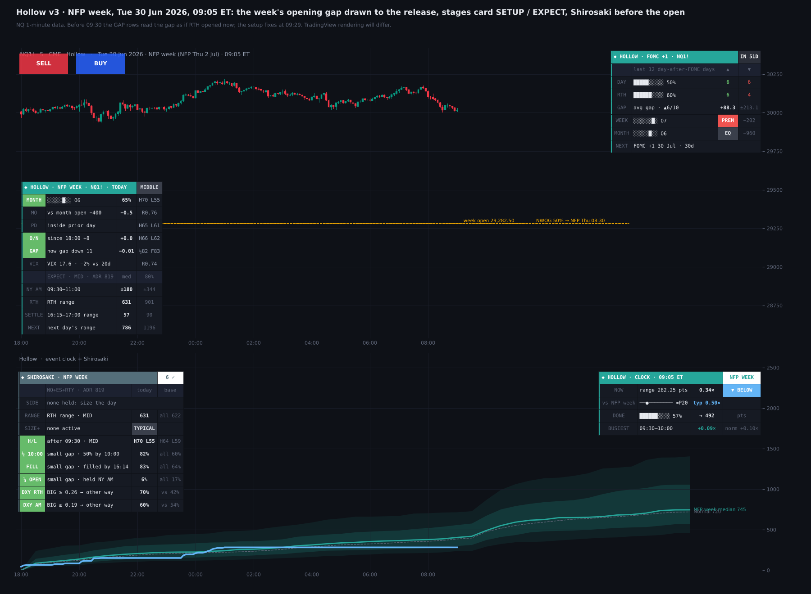
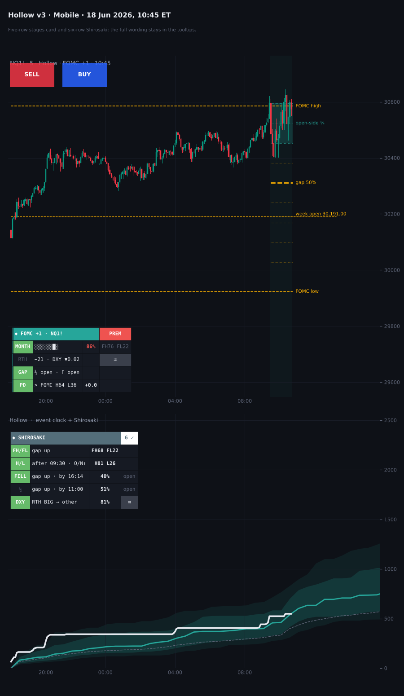

# Hollow

**NFP Week & Day-After-FOMC Model for NQ, ES & RTY**

TradingView indicator, Pine Script v6. Open source under the Mozilla Public License 2.0.

*Mock-up of how it looks on the chart.*

**Hollow** maps the two days around the big releases that nobody marks: Monday–Thursday of NFP week (Model 11) and the day after FOMC (Model 12, Full Bringer). It covers five things:

- the levels those days trade around;
- how far days with today's setup usually move, at today's ADR20;
- NY AM and RTH live against the dollar;
- Shirosaki, a table of what held for today's setup;
- today's range against the typical day of its kind.

The figures are pooled across NQ, ES and RTY: 329 NFP weeks (970 symbol-days) and 67 days after FOMC (196 symbol-days). A ✓ row held in 2018–24, again in 2025–26, and on each of the three markets. *It is a map of how these days usually behave, not a signal generator.*

## What it draws on price

- **NFP week's opening gap:** the prior week's last close and Sunday's 18:00 open, with their midpoint, drawn to the NFP release. Its midpoint traded by the release in 96% of NFP weeks.
- **FOMC high and low:** the FOMC day's high and low (its 18:00–17:00 session), carried through the next day to 16:14.
- **RTH gap:** on Hollow days, the prior 16:14 close and the gap's 50% from 09:30.
- **Gap octants (day after FOMC):** the gap in eighths over NY AM, the 50% line bold and the quarter next to the open shaded.
- **Settlement window (NFP week):** 16:15–17:00 shaded.
- **NFP and FOMC flags:** above the release bar, tied by a stem to the 08:30 or 14:00 open.
- **Week open:** carried right of price.

## Stages card

The card reads whichever Hollow day is current or next. The header pill shows where price sits in the month's range: *discount* (bottom quarter), *middle* or *premium* (top quarter). It comes first because it is the setup that sized these days most.

**SETUP** runs live, then is fixed at 09:29. Each row shows the odds for its group:

- the day after FOMC: the FOMC day's afternoon (14:00 → 16:14), with how often the next RTH took the FOMC high and low;
- the month's octant;
- NFP week: the distance from the month's open;
- the prior day's high and low (the FOMC day's the day after);
- the move since 18:00;
- the RTH gap (before 09:30, the gap if it opened now);
- VIX against its 20-day average.

**EXPECT** (before 09:30) gives the median and 80th percentile at today's ADR20 for NY AM and the RTH range, then the settlement window and the next day (NFP week) or the next day and the open-side quarter (the day after FOMC).

**LIVE** (from 09:30) shows:

- NY AM and RTH in points, against DXY's move in the same window;
- the range since 09:30 against the expected median;
- the gap's 50% and fill, with the time each was hit.

## Shirosaki (indicator pane)

Shirosaki lists what held for today's setup, in points at today's ADR20. Once RTH opens, its gap rows show what happened today, and its DXY rows carry a live pill.

**NFP week:**

- **RTH range** by the month's position: **0.94** ADR from a discount vs **0.66** from a premium ✓. A second row lists the other size groups active today and whether they all point bigger or smaller:
  - VIX more than 10% over its average: 0.97 ✓; more than 10% under: 0.59 ✓;
  - more than 1 ADR under the month's open: 0.90 ✓; over: 0.67 ✓;
  - below the prior day's low 0.93 ✓; above its high 0.66 ✓; an overnight down more than 0.4 ADR 1.06 ✓.
- **New high / low after 09:30** for the most specific group active today:
  - overnight down more than 0.4 ADR: new high 27% ✓, new low 78% ✓;
  - above the prior day's high: new high 76% ✓, new low 43% ✓;
  - from a monthly discount: new high 45% ✓, new low 76% ✓.
- **The RTH gap:**
  - a small gap (within 0.25 ADR): 50% by 10:00 **82%** ✓, filled by 16:14 **83%** ✓;
  - a gap up more than 0.25 ADR: 50% by 10:00 32% ✓, filled 37% ✓;
  - the open-side quarter held through NY AM: 32% on a gap up, 6% on a small gap ✓.
- **DXY:** once DXY's move over RTH reached 0.26 of its ADR20, the index went the other way **70%** vs 42% ✓ (NY AM, 0.19: 60% vs 54% ✓, barely).

**Day after FOMC:**

- **Did RTH take the FOMC high / low?**
  - from a monthly premium: high 76% ✓, low 22% ✓; from a discount: high 9% ✓, low 86% ✓;
  - after an FOMC afternoon up: high 73% ✓, low 28% ✓; down: high 24% ✓, low 61% ✓;
  - a gap up more than 0.25 ADR: high 68% ✓, low 22% ✓; a gap down: high 15% ✓, low 78% ✓.
- **RTH range:** VIX more than 10% over its average 1.26 ADR ✓; under 0.74 ✓.
- **New high / low after 09:30:** after an overnight up more than 0.4 ADR, new high 81% ✓ and new low 26% ✓.
- **The gap:** a small gap filled 81% ✓ and its 50% traded in NY AM 80% ✓.
- **DXY:** once DXY's RTH move reached 0.52 of its ADR20, the index went the other way **81%** vs 41% ✓.

**Side:** a HYDRA search over everything knowable at 09:29 found no feature that called the direction out of sample on either day. Of 90 pre-specified direction tests, 5 passed the ✓ rule, about what chance gives at that many tries. Shirosaki's SIDE row shows the two that lean 60 / 40 or more, and says so in its tooltip:

- NFP week, after an overnight up more than 0.4 ADR: RTH closed up 69% vs 54% ✓;
- day after FOMC, with VIX within 10% of its average: NY AM went down 64% vs 42% ✓ (barely held in 2025–26).

Otherwise it reads *none held: size the day*.

## Event clock and tally

- **Event clock (pane):** today's running range from 18:00 (or its net move) against NFP-week days, days after FOMC or normal days at the same time of day. It shows the median path with 25–75% and 10–90% bands, in half-hour steps at today's ADR20. A NOW status reads *Above*, *Inside* or *Below* the middle half.
- **Tally card:**
  - the last N days after FOMC: up and down closes and their average RTH gap;
  - where price sits in this week's and this month's range, by octant;
  - the next Hollow day.

  *The octant is a locator, not a tested signal.*

## Settings

**View** sits at the top, the same as in my other indicators:

- **Pane:** clock + Shirosaki, the clock, Shirosaki, or cards only;
- **Clock measure:** range or net move;
- **Theme:** Auto follows the chart;
- **Layout:** Desktop or Mobile;
- **Card text:** tiny, small or normal.

**Model structure** has on/off, colour and style for the NFP week's opening gap and the FOMC high / low, plus the gap octants, the settlement window, the week open, the RTH gap and the label size.

**Mobile** folds the cards for a phone: a five-row stages card and a six-row Shirosaki. The full wording stays in the tooltips.

## How to use

- Built for **NQ / MNQ**, **ES / MES** and **RTY / M2K**, continuous or front month. On other symbols the clock and tally show NQ's figures.
- 1 to 15-minute charts suit the levels. The live rows need 30 minutes or less, and the clock 60 minutes or less.
- Make the indicator pane tall enough for Shirosaki.
- For a phone, use a separate chart layout with *Layout = Mobile*, since chart layouts sync across devices.

## Data and method

- NQ, ES and RTY front-month 1-minute data, Jan 2018 – Oct 2026.
- HYDRA: about 410 candidate features × 15 targets on 2018–24, kept against 20 shifted-target nulls, then a locked 2025–26 test and the same sign on each symbol.
- A row gets a ✓ only if all of these held:
  - p < 0.05 with errors clustered by date;
  - the same side in 2018–24 and in 2025–26;
  - the same side on each of NQ, ES and RTY.
- Many group tests were run across the calendar models, so treat the ✓ rows as the steadiest descriptions, not proven edges. The rows with the most days behind them (the gap on NFP-week days, the RTH range by month position and VIX, the FOMC high / low by month position) are the most dependable. The day-after-FOMC rows rest on 67 days.
- DXY rows: DXY futures, Feb 2023 – Jul 2026. On the chart they read TVC:DXY, which can be changed in the inputs.
- **ADR20** = mean (high − low) of the last 20 complete trading days.
- NFP and FOMC dates come from the BLS and Federal Reserve schedules and are loaded to Dec 2027.
- No higher-timeframe value leaks future data.

## Limitations

*These are historical frequencies: useful context, not guarantees.* Same-window DXY rows describe how the session finishes and cannot be known in advance. In Bar Replay, TradingView may not feed TVC:DXY minute by minute, so the DXY pills can read near zero there. Nothing here is financial advice.

## Credits

ICT concepts (*Michael J. Huddleston*): the RTH gap and its 50%, the opening gap, premium and discount. Event clock after Kyōka Suigetsu. Part of the Hueco Mundo set; Shirosaki is Hollow's inner hollow. Written from scratch; open source under MPL 2.0.

## Add it to TradingView

1. In TradingView, open the **Pine Editor** (bottom panel).
2. Copy the contents of `Hollow.pine` into a new script.
3. **Save**, then **Add to chart**.

## More screenshots

## License

Mozilla Public License 2.0, see [LICENSE](LICENSE). © Unclehk2000.

*Historical frequencies, not guarantees. Nothing here is financial advice.*
